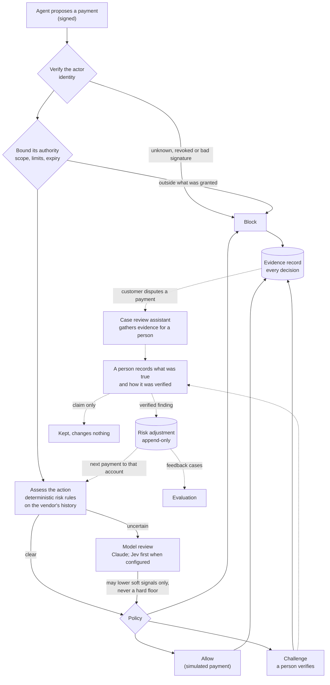

# Zeta One

**Trust and risk checks for AI agents that move money.**

> Autonomy without instability.

Businesses are starting to let AI agents pay their bills. A known agent with valid permissions can
still be manipulated: an invoice can carry instructions, and a vendor's bank details can be swapped.
Before a financial platform carries out an agent's payment, Zeta One answers three separate
questions and returns **allow**, **challenge** or **block**, with an evidence record saying why.

| | Question | How it is answered |
| --- | --- | --- |
| **Verify the actor** | Who is acting, and for which business? | The agent signs each request (Ed25519); unknown or revoked agents are blocked |
| **Bound its authority** | Did the business authorize this payment? | Scope, limits, expiry and revocation, checked in code |
| **Assess the action** | Is it fraud anyway? | Deterministic risk rules on the payment's context; a model reviews only the uncertain cases |

Built for the AITX & MLOps World Community Hackathon (Austin Tech Week, October 2026), Rho fintech
track, on Rho's API. It is not a Rho product. **Payment execution is simulated.**

## How a decision is made



Solid lines are the decision; dotted lines are the feedback loop.

**What makes it different**

- **No model can talk a payment past a hard check.** Identity, authorization and hard risk flags
  are deterministic floors. A model may only lower soft signals, and each lowering is recorded.
- **Most payments need no model.** Only the uncertain fraction is escalated. The evaluation reports
  cost per 1,000 decisions next to fraud caught and friction caused, for rules alone, Jev, an
  open-weight model and Claude on everything.
- **The loop closes, and it is audited.** A verified fraud blocks that bank account for the
  business; a verified bank-detail change stops costing friction. A customer's report alone changes
  nothing. Each change is an append-only record the next decision cites.
- **Agents help people, not instead of them.** When a customer disputes a payment, an assistant
  gathers the internal records, researches the vendor on the web and links every point to its
  source. It has no verdict field; a person decides.

## What runs today

| Part | State |
| --- | --- |
| Gateway: identity, authorization, risk rules, policy, evidence, simulated payments | Working end to end over HTTP, on synthetic data in Rho's shapes |
| Model review: Claude Opus 5.5; Jev (OpenRouter, TypeSafe as backup); open-weight arm | Each answers live calls; not yet run on the evaluation |
| Feedback loop: verified outcomes and risk adjustments | Working; recorded end to end in `site/data/loop.json` |
| Case review page with source links and a local chat model | Working against stubs; the research and chat need keys and a local model |
| Evaluation: labelled `dev` and `test` sets, seven configurations, cost table | Sets generated; labelling and the scored run are in progress |
| Rho | Read-only: the API cannot make payments, so execution is simulated |

## Quick start

```bash
uv venv .venv && uv pip install --python .venv/bin/python -r requirements-dev.txt
cp .env.example .env                 # keys are optional; see below
python3 scripts/check.py             # compile, secret, link and docs checks, then the tests
.venv/bin/python scripts/keygen.py   # once: the demo agent's signing key
.venv/bin/uvicorn zeta_one.gateway.app:app --port 8000
```

Then, with the gateway running:

```bash
curl -s -X POST localhost:8000/v1/scenarios/vendor_payment_method_changed/run -H 'Content-Type: application/json' -d '{}'
```

Open `http://localhost:8000/review` for the case review page. It asks for `ZETA_ADMIN_TOKEN` from
`.env`.

Reproduce the recorded runs the site shows:

```bash
.venv/bin/python scripts/demo_loop.py      # the feedback loop, no model calls
.venv/bin/python scripts/record_runs.py    # scenario results and the evaluation report
```

**Environment** (`.env.example` lists every variable):

| Variable | Needed for |
| --- | --- |
| `ZETA_ADMIN_TOKEN` | Admin endpoints and the review page; `scripts/keygen.py` writes it to `.env` |
| `ANTHROPIC_API_KEY` | Claude model review and the case review assistant |
| `OPENROUTER_API_KEY`, `TYPESAFE_API_KEY` | Jev and the open-weight arm |
| `CHAT_BASE_URL`, `CHAT_MODEL` | The case chat on a local model (`ollama pull qwen2.5:7b`) |
| `RHO_API_TOKEN` | The read-only Rho staging check (needs the hackathon VPN) |

With no keys, everything runs: escalated cases are held for a person and the tests use stubs.

## Tech stack

Python 3.14, FastAPI, Pydantic, SQLite, pytest and Hypothesis. Claude Opus 5.5 through the
Anthropic API; Jev and the open-weight model through OpenRouter; the chat through Ollama. A static
site in `site/`. Where each piece runs is in
[docs/strategy/architecture.md](docs/strategy/architecture.md).

## Data

All data in this repository is synthetic. The seed (`data/seed/`) is generated by
`zeta_one/rho/seed.py` with a fixed random seed, in the shapes of Rho's API; its provenance is in
`data/seed/provenance.json`. Evaluation cases are generated from a fixed seed with independently
written wording, and are labelled blind. Raw Rho staging data never leaves the laptop. See
[docs/reference/staging-data.md](docs/reference/staging-data.md) and
[docs/strategy/evaluation.md](docs/strategy/evaluation.md).

## Limitations

- Synthetic results are not production accuracy.
- Protection covers only payments routed through the gateway; an agent that bypasses it is not
  checked.
- Authorization records are unsigned and the evidence store is editable by whoever runs the
  gateway.
- Bank-detail changes made before monitoring began may be invisible.
- Jev's probabilities are treated as uncalibrated until our cases can measure them.

What is not done is in [docs/roadmap.md](docs/roadmap.md).

## Documentation

- [docs/strategy/product.md](docs/strategy/product.md): the problem, the decision model and scope.
- [docs/reference/demo-api.md](docs/reference/demo-api.md): the HTTP API and the evidence record.
- [docs/README.md](docs/README.md): every document.
