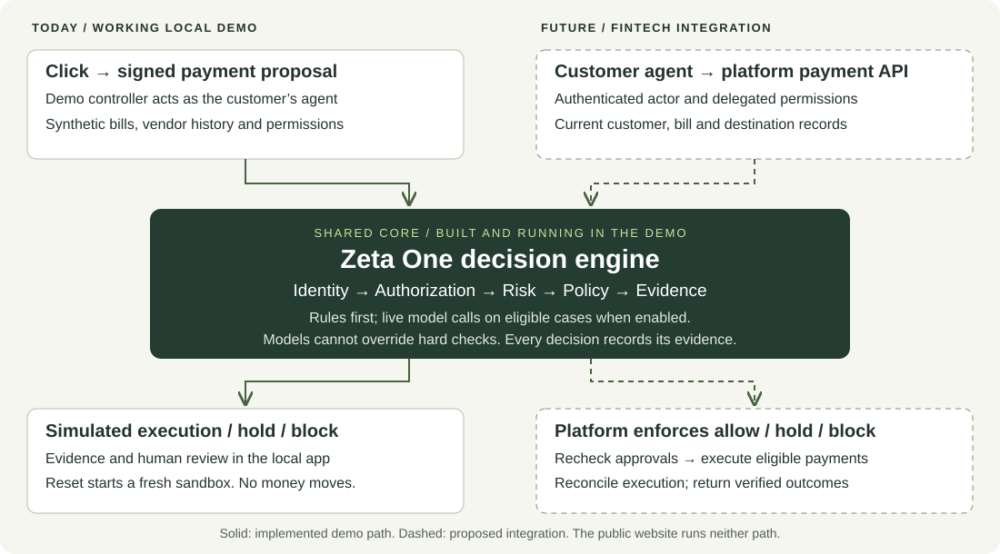

#  Zeta One

**Trust and risk intelligence for AI agents that move money.**

*Autonomy without instability.*

**[Explore the public site](https://zeta-one-site.vercel.app/)** — the project explanation, evaluation
and recorded payment review workspace. Hosted on Vercel; live decisions run in the local demo.

Businesses are starting to let AI agents pay their bills. A known agent with valid permissions can
still be manipulated: an invoice can carry instructions, and a vendor's bank details can be swapped.
Zeta One checks each proposed payment before execution and returns **allow**, **challenge** or
**block**, with an evidence record saying why.

| | Question | How it is answered |
| --- | --- | --- |
| **Verify the actor** | Who is acting, and for which business? | Signed requests; unknown or revoked agents are blocked |
| **Bound its authority** | Did the business authorize this payment? | Scope, limits, expiry and revocation, checked in code |
| **Assess the action** | Is it fraud anyway? | Rules first; Jev, a typed decision model, next; a language model only where needed; a person verifies held payments |

Built for the [AITX & MLOps World Community Hackathon](https://common-scooter-829.notion.site/AITX-MLOps-World-Community-Hackathon-Austin-Tech-Week-4021e636288e81e08278fd9a977d7639)
(Austin Tech Week, October 2026), in the [Rho](https://www.rho.co/) fintech track, using Rho's API
shapes and a read-only staging connection. It is not a Rho product. **Payment execution is simulated.**

## Features

| Feature | What it does |
| --- | --- |
| **Decision engine** | Checks each signed payment proposal before it moves: identity, then authorization, then risk (rules first, Jev next, a language model only where needed). Code enforces the hard limits and returns allow, challenge or block with an evidence record |
| **Case review assistant** | Helps the people who work fraud disputes. Code gathers the decision, the payee's payment history and the bank-change timeline; a separate call researches the vendor on the web from public facts only. The case file cites a record or URL for every fact, and a local model answers questions about it. It has no verdict field: a person records the finding |
| **Feedback loop** | A finding a person verified becomes a scoped, revocable risk adjustment that the next payment cites. A customer's report alone changes nothing |
| **Payment workspace** | An inbox of synthetic payments: open one, read its invoice and evidence, review held payments. The public site shows recorded engine runs; run it locally for fresh decisions ([guide](docs/reference/payment-workspace.md)) |

## How a decision is made

<picture>
  <source media="(prefers-color-scheme: dark)" srcset="docs/images/decision-flow-dark.svg">
  
</picture>

## What makes it different

- **Cost savings through the right intelligence at each step.** Rules handle routine checks.
  [Jev](https://typesafe.ai/blog/introducing-system-one-models-and-jev) answers fixed questions with
  typed values and probabilities rather than generating prose, making it a deliberate low-cost
  decision tier. Language models handle deeper interpretation; people supply verification that
  models cannot establish. Configurations let us compare this cascade with direct model review.
- **Security with a path to private inference.** Hard permissions stay in code, outside the agent's
  control. We evaluated Qwen 3.6 27B on a rented GPU we controlled, simulating a fintech serving a
  model on its own infrastructure. This demonstrates the risk-model deployment path for keeping
  case data within a fintech's environment; hosted Jev, Claude and web research still send data to
  external services when used. [OpenJev](https://github.com/TheoLeeCJ/SemIf-OpenJev), an independent
  Jev-style implementation, is a possible self-hosted decision tier, not one we evaluated.
  [Deployment details](docs/decisions/0018-self-hosted-open-weight-arm.md).
- **Customer friction counts as a cost.** Match the interruption to the risk: allow routine
  payments, hold unresolved questions for a person, and block clear violations. We measure
  legitimate payments held or blocked alongside fraud allowed, model spend and latency. A
  legitimate payment needing verification is not automatically an unnecessary challenge.
- **Evaluation using traditional ML methods.** Separate development and frozen test/hard sets,
  blind labeling with human checks and adjudication, simple baselines, per-category confusion
  matrices and confidence intervals, paired comparisons, and error analysis. We report where the
  models help and where they fail, with the data and label limitations alongside the results.
- **A feedback loop with people in control.** A person's verified finding can block a payment
  method or turn a confirmed bank change into a soft signal. Reports alone change no trust.
  Each adjustment is scoped, revocable and cited by later decisions. An assistant gathers records,
  researches the vendor and links its claims to sources for case review; people record findings
  and make consequential decisions.

## How it fits into a fintech

Zeta One is built to sit in a financial platform's payment path, such as Rho's, between a
customer's agent and the money moving. The local demo runs the same decision engine a platform
would connect to its own records and payment execution.



What a fintech needs to connect:

| | What it means |
| --- | --- |
| **Enforcement** | Put the engine in the payment path and enforce allow, hold or block on the server, with no route around the checks |
| **Authority** | Bind each agent to its customer and delegated limits; connect identity, expiry and revocation to platform systems |
| **Context** | Supply current bills, vendor and bank-change history, and settled or held payments, keeping each customer's data apart |
| **Execution** | Bind the decision to the exact payment, recheck changed state, reserve spend and prevent duplicate execution |
| **Review** | Route holds to authorized staff, record what they verified and how, and keep trust adjustments traceable and revocable |
| **Operations** | Add durable storage, monitoring and outage handling; validate in shadow mode on representative data before enforcing |

Rho's API has no payment-write endpoint or pre-execution hook today, so none of these connections
is implemented here. The [integration guide](docs/reference/fintech-integration.md) has the detail.

## Results

One run per configuration on synthetic cases, recorded on 29 October 2026:

- **Models reduced friction, with a safety trade-off.** On 100 generated test cases, rules held or
  blocked 39 of 51 legitimate payments and allowed none of 49 frauds. The Jev cascade reduced that
  legitimate workload to 14, but allowed two frauds.
- **A self-hosted open-weight model held its own.** Qwen 3.6 27B on one rented GPU decided 94 of
  100 test cases acceptably, the most of any configuration, at about an eighth of the cost of Opus
  on the same escalated cases. Its prompt was tuned on its own development errors, and on the hard
  set it scored 7 of 12 to Opus's 10.
- **Selective inference has a blind spot.** Two detectable frauds in the separately authored hard
  set triggered no rule and bypassed selective model review. Opus on every payment caught both.

These are findings about this small synthetic evaluation, not production accuracy or savings.
See the [full report](data/eval/report.md) for costs, latency, intervals, label agreement, known
policy errors and comparison limits, or the [evaluation walkthrough](docs/reference/evaluation-system.md).

## Quick start

```bash
uv venv .venv && uv pip install --python .venv/bin/python -r requirements-dev.txt
cp .env.example .env                 # keys are optional; see below
python3 scripts/check.py             # compile, secret, link and docs checks, then the tests
.venv/bin/python scripts/keygen.py   # once: the demo agent's signing key
.venv/bin/uvicorn zeta_one.gateway.app:app --port 8000
```

For the payment-review workspace, run the demo on its own sandbox and open
`http://127.0.0.1:8001/workspace/`. The original guided story remains at `/demo`:

```bash
.venv/bin/uvicorn zeta_one.demo.app:app --port 8001
```

Choose a scenario, inspect its evidence and review held payments. The
[workspace guide](docs/reference/payment-workspace.md) explains the recorded public preview and
fresh local assessments. Models are off unless it is started with
`ZETA_DEMO_LIVE=1`, which calls Claude for escalations and case files (paid).

Or, with the gateway running:

```bash
curl -s -X POST localhost:8000/v1/scenarios/vendor_payment_method_changed/run -H 'Content-Type: application/json' -d '{}'
```

Open `http://localhost:8000/review` for the case review page. It asks for `ZETA_ADMIN_TOKEN` from
`.env`.

Reproduce the recorded runs the site shows:

```bash
.venv/bin/python scripts/demo_loop.py      # the feedback loop, no model calls
.venv/bin/python scripts/record_runs.py    # scenario results and the evaluation report
```

**Environment** (`.env.example` lists every variable):

| Variable | Needed for |
| --- | --- |
| `ZETA_ADMIN_TOKEN` | Admin endpoints and the review page; `scripts/keygen.py` writes it to `.env` |
| `ANTHROPIC_API_KEY` | Claude model review and the case review assistant |
| `OPENROUTER_API_KEY`, `TYPESAFE_API_KEY` | Jev |
| `OPEN_WEIGHT_BASE_URL`, `OPEN_WEIGHT_MODEL`, `OPEN_WEIGHT_API_KEY`, `OPEN_WEIGHT_GPU_HOURLY` | The open-weight arm on its own GPU server |
| `CHAT_BASE_URL`, `CHAT_MODEL` | The case chat on a local model (`ollama pull qwen2.5:7b`) |
| `RHO_API_TOKEN` | The read-only Rho staging check (needs the hackathon VPN) |

With no keys, everything runs: escalated cases are held for a person and the tests use stubs.

## Tech stack

Python 3.13 or later (CI runs 3.14), FastAPI, Pydantic, SQLite, pytest and Hypothesis.

| Piece | What it is | How Zeta One reaches it |
| --- | --- | --- |
| [Claude Opus 5.5](https://www.anthropic.com/claude) | Anthropic's large language model; the strong risk tier | The Anthropic API |
| [Jev](https://typesafe.ai/blog/introducing-system-one-models-and-jev) | TypeSafe's typed decision model (a "System One" model): it answers fixed questions with probabilities instead of writing text; the cheap risk tier ([details](docs/reference/jev.md)) | [OpenRouter](https://openrouter.ai), a service that routes one API to many model providers; TypeSafe's own API as the backup |
| [Qwen 3.6 27B](https://huggingface.co/Qwen/Qwen3.6-27B-FP8) | An open-weight model (weights published under Apache 2.0), compared in Opus's place | [vLLM](https://docs.vllm.ai), an open-source model server, on one GPU we rent |
| [Ollama](https://ollama.com) | Runs a small model locally | The case review page's chat |

Requests use **Ed25519**, a digital-signature scheme. Each registered agent signs a request with
its private key; the gateway uses the corresponding public key to verify who signed it and that
its contents have not changed. Timestamps and one-use nonces guard against replay. A valid signature
establishes possession of the registered key, not that the payment is legitimate.

A static site is in `site/`. Where each piece runs is in
[docs/strategy/architecture.md](docs/strategy/architecture.md).

## Data

All data in this repository is synthetic. The seed (`data/seed/`) is generated by
`zeta_one/rho/seed.py` with a fixed random seed, in the shapes of Rho's API; its provenance is in
`data/seed/provenance.json`. Evaluation cases are generated from a fixed seed; Claude Haiku 5.5
writes their wording without seeing the labels, Claude Sonnet 5.5 labels them blind, and a person
checks a sample. The `hard` set is written outside the generator, drafted with Claude and approved by
a person. Raw Rho staging data never leaves the laptop. See
[docs/reference/staging-data.md](docs/reference/staging-data.md) and
[docs/strategy/evaluation.md](docs/strategy/evaluation.md).

## Limitations

### Product design and trust boundaries

- Only payments routed through the gateway are protected; an agent with another execution route
  can bypass it. Real deployment needs mandatory checks before money moves.
- A “verified” finding is a person's recorded statement of how they checked. The gateway does not
  confirm that check, and the admin token is shared rather than tied to an individual.
- Authorization records are unsigned, and the evidence store is editable by its operator.

### Engineering

- Jev's probabilities have not been calibrated on this task and are treated as uncalibrated.
- Self-hosted risk inference was tested on rented hardware with synthetic data. A fully private
  deployment also needs local alternatives or disabled hosted review and research services.
- Known policy errors and differences between evaluated versions remain documented in the
  [report](data/eval/report.md); this is not a production-ready payment integration.

### Evaluation

- Synthetic results are not production accuracy. **Improving generator diversity is the first
  evaluation priority:** time constraints left a narrow range of vendor histories, billing
  patterns and bank records. Its dimensions resemble the rules, and 15 test combinations also
  occur in development, so generated cases flatter the rules.
- The datasets are small: 100 generated test cases and 14 separately authored hard cases, of which
  12 are scored. Each configuration ran once; uncertainty is wide and comparisons are limited.
- Labels are only partly human-checked. Initial AI–human agreement on 40 test cases was 45%, about chance;
  disagreements were adjudicated, while 60 test labels remain AI-only. These limits constrain
  what the scores establish.

## Next steps

1. **Broaden and strengthen evaluation.** Start with more varied histories and unfamiliar fraud
   wording, independent human labels and a fresh holdout; repeat runs to measure model variability.
2. **Resolve the observed policy errors and validate uncertainty.** Add development regressions,
   measure Jev's calibration, and test attacks that evade the escalation rules.
3. **Validate private deployment.** Evaluate a self-hosted Jev-style tier such as OpenJev, including
   prompt-injection resistance, and establish data boundaries for every review component.
4. **Pilot with a fintech in shadow mode.** Connect representative records, per-person review
   permissions and reliable execution controls before enabling real payments. The
   [integration guide](docs/reference/fintech-integration.md) explains the work required.

## Documentation

- [Product](docs/strategy/product.md): the problem, decision model and scope.
- [Evaluation design](docs/strategy/evaluation.md): datasets, labeling, comparisons and metrics.
- [Evaluation system](docs/reference/evaluation-system.md): how to run it and reproduce the report.
- [Fintech integration](docs/reference/fintech-integration.md): the path from this demo to platform enforcement.
- [Architecture](docs/strategy/architecture.md): components, deployment and data boundaries.
- [Documentation README](docs/README.md): the complete documentation index.
