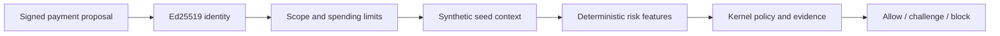

# Deterministic engine stages

The seed context, Ed25519 identity verifier, authorization checker and deterministic risk tier
are implemented. The five demo decisions are tested together through `Engine` with these real
stages and no model calls. These are synthetic acceptance tests, not fraud-accuracy measurements.

## Data and context

`zeta_one.rho.snapshot.Store()` loads committed `data/seed/` JSON into a fresh in-memory SQLite
database. It owns `rho_` tables and can be closed or used as a context manager. It never loads raw
staging snapshots or calls Rho. `store.seed_version` hashes relative filenames and file bytes in
sorted order, including the provenance file. Mutations affect only that store; the version identifies
the source seed, not subsequent case setup.

Regenerate with `.venv/bin/python scripts/make_seed.py`. The seed's provenance is in
[`data/seed/provenance.json`](../../data/seed/provenance.json): hand-specified fixture entities and
fixed-seed filler based on small-business assumptions, not staging statistics. There are 23
counterparties, three accounts and 150 simulated outgoing transactions. Paid bills link every
historical payment to its counterparty, so the total bill count exceeds the plan's approximate
30 invoices. Some demo history extends beyond twelve months to preserve fixture dates.

`zeta_one.rho.seed.SEED_NOW` is `2026-10-27T22:00:00Z`; use it for demo and evaluation clocks.
`context_for(store)` in `rho/view.py` returns a `ContextSource` callable:
`(proposal, business_id, now) -> Context`.

- Counterparty, source account and named bill must belong to the business; the method must belong
  to the proposed counterparty. Invalid references raise `InvalidProposal`.
- History joins paid bills to settled outgoing transactions, deduplicates transaction IDs, and
  excludes future transactions and other currencies. Count and median use all qualifying history;
  `recent` contains at most three payments within 90 days.
- Open bills are looked up independently of the proposal's bill reference. A bill for another
  payee also supplies that payee and its history for the risk assessment.
- Amounts and payee records follow the portions of Rho's shapes the engine reads. Ownership,
  method dates/history and invoice text are synthetic stand-in records.

`rho.mutations.apply(store, SetupOp(...))` supports `change_payment_method`, `set_bill_text`,
`add_counterparty`, `add_bill` and `add_payments`. Its
[module docstring](../../zeta_one/rho/mutations.py) is the argument reference, including the names
used by the evaluation generator. Verification provenance on a setup record never overrides risk.
Each evaluation case needs its own fresh store. Apply setup before concurrent reads.

## Identity and authorization

Construct `identity.registry.Registry(connection)` and `authorization.store.Store(connection)`
on a SQLite connection. They own separate tables. For gateway worker threads, use `zeta_one.db.connect`
or an equivalently configured connection. Use an in-memory connection for isolated tests; file-backed
connections preserve registrations, grants and nonces across restarts.

| Entry point | Purpose |
| --- | --- |
| `registry.register(agent_id, business_id, owner, public_key, now)` | Register an Ed25519 public key; duplicate IDs are rejected |
| `registry.get(agent_id)` / `registry.revoke(agent_id, now)` | Read agent state / revoke future requests |
| `identity.signing.sign(private_key, agent_id, method, path, body, now)` | Return signature headers for the exact raw body bytes |
| `identity.signing.verifier(registry)` | Return the `IdentityVerifier` callable |
| `authorization_store.grant(authorization)` | Store an active authorization with a strictly increasing version per business and agent |
| `authorization_store.revoke(authorization_id, now)` | Revoke the matching current authorization |
| `authorization_store.loader()` | Return the `AuthorizationSource` callable |
| `authorization.check.checker(spend)` | Return the `AuthorizationChecker` using the gateway's `SpendSource` |

Verification checks presence, registration, active status, timestamp within inclusive ±300 seconds,
nonce reuse, then the signature. Invalid signatures do not consume nonces. Nonces expire at the end
of the signed timestamp's acceptance window, including timestamps ahead of the server clock.

Authorization checks collect every violation: status, business, agent, action, counterparty scope,
expiry, per-payment cap and rolling cap. An expiry without a timezone fails closed as an expiry
violation. Currency comparisons are strict; equal-to-cap payments pass.
Rolling spend includes held and executed payments supplied by the gateway. Missing or revoked grants
block. New-payee permission and human-approval thresholds remain policy challenges, not scope blocks.
Authorizations are stored unsigned; unknown fields are preserved but not enforced.

`.venv/bin/python scripts/keygen.py` creates missing local demo keys under gitignored `data/keys/`
and adds an admin token to `.env` if absent. It does not print credentials. The repository checks
reject tracked keys. Integration tests generate temporary keys in memory; running keygen is not
required for the test suite.

## Tier 0

`risk.tier0.Tier0()` is callable as `(proposal, context, now) -> Tier0Output`. Features use only
these arguments and carry evidence IDs. The lexicon in `risk/features.py` is frozen as of
2026-10-27, before evaluation test-set generation. It is a heuristic signal, not proof of fraud.

| Feature | Implemented meaning |
| --- | --- |
| `counterparty_is_new` | Created within 30 elapsed days, or no settled payment history |
| `payment_method_changed_days_ago` | Whole days since the latest change to the proposed method; no inference from its initial addition date |
| `amount_ratio_to_vendor_median` | Same-currency ratio to a positive median; rounded display value plus unrounded threshold value |
| `bill_mismatch` | Named bill differs in ID, amount/currency, payee, or an explicitly supplied optional method ID |
| `document_instruction_patterns` | Fixed case-insensitive patterns in the named bill and independently discovered open bills |
| `bill_not_referenced` | No bill named and an open bill exists, or the payee is new or recently changed |

Mismatch or a missing reference with a new/recently changed payee produces high risk. Other active
features produce elevated risk; no active feature produces low risk. The kernel's escalation module
alone computes the enforced floor and merges model results. Integer method ages through day 30
count as recent. An absent, zero or wrong-currency median yields no amount-ratio signal.

## Gateway handoff and verification

The default `gateway.wiring.real_stages()` still needs these implementations registered, including
persistent registry/grant administration and built-in signed demo requests. The scenario fallback
and evaluation replay backend remain in place until that wiring lands. Do not describe the default
HTTP path as fully using these stages yet.

`tests/test_stage_integration.py` composes all four callables into `Engine`, uses the seed clock,
and verifies the five expected decisions and reasons with `tiers=["tier0"]`. Stage-specific tests
also cover fixture context/feature parity, mutation isolation, persistent nonces, signature tampering,
individual authorization violations and amount boundaries. `python3 scripts/check.py` runs them all.
No live Rho or model call is required; the separately opted-in live-model test is not part of this
verification.
