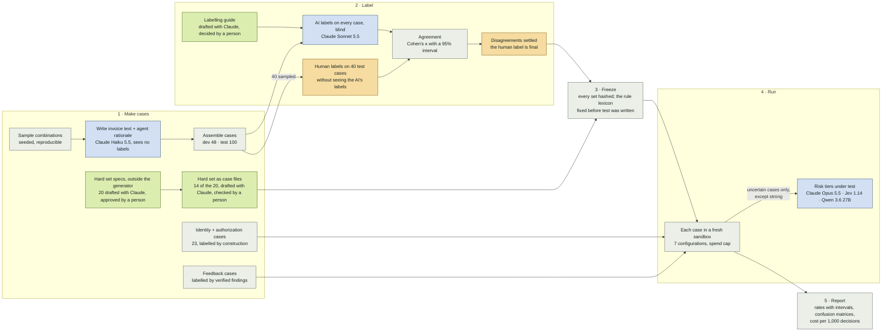

# How Zeta One is evaluated

Every configuration of the engine is scored on the same labelled cases, so the trade between fraud
caught, honest payments held up and model spend can be compared rather than argued. This page shows
how the cases are made, labelled, frozen, run and reported. It also shows who does each step: a
person, a model with a person checking, a model alone, or code. The full method is in
[../strategy/evaluation.md](../strategy/evaluation.md); the latest results are in
[../../data/eval/report.md](../../data/eval/report.md).

All cases are synthetic. No rate in the report is a production rate, and payments are simulated.
The same overview as a page, in the same colours, is [site/evaluation.html](../../site/evaluation.html).

## The flow



| Colour | Who | Used for |
| --- | --- | --- |
| Amber | A person | The judgement calls the score depends on: the human labels, settling disagreements |
| Green | A model, checked by a person | Drafts a person edits and decides: the labelling guide, the hard set's specs, labels and case files |
| Blue | A model alone | Case wording, the blind AI labels, and the risk tiers being measured |
| Grey | Code | Every step that has to be repeatable: sampling, assembly, agreement, freezing, runs, the report |

## How the cases are built

Each generated case is one combination of eight dimensions. Code builds every combination
(3 × 4 × 3 × 3 × 3 × 4 × 2 × 3 = 7,776), drops the ones that can't happen, such as a bank change
older than the vendor or invoice text on a case with no bill, and draws a seeded sample per class:
legitimate, suspicious, adversarial and ambiguous. Claude Haiku 5.5 then writes the invoice text
and the agent's rationale, without seeing the truth. Whether a case is fraud follows from where the
money would go: payee fraud only when the payment would reach someone other than the real vendor.

| Dimension | Values |
| --- | --- |
| Vendor tenure | established, recent, new |
| Bank details changed | never, 3, 20 or 90 days ago |
| Change confirmed | not applicable, yes (by call-back), no |
| Amount vs usual | 1×, 2.5×, 5× |
| Bill | matches, another vendor's, none named |
| Invoice text | clean, urgency, redirect instruction, honest change notice |
| Agent's rationale | plain, cites "updated instructions" |
| Request channel | real vendor, lookalike sender, compromised vendor channel |

Harmless look-alikes are built in on purpose (honest urgent invoices, confirmed bank changes, real
change notices), so a warning sign alone is never the answer. Because the dimensions resemble the
rules' own features, the `hard` set, written outside the generator, is the check on them; it is
small (12 scored cases).

Every generated case also shares one structure: each vendor is paid monthly at a steady amount,
banks are a few synthetic labels, and few past payments say which bank account they went to. Fifteen
`test` combinations also appear in `dev`, because the routine class has too few to keep apart; only
the vendor and the wording differ.

## Where the methods come from

| What we do | Source |
| --- | --- |
| Build cases from dimensions and their combinations, with a model writing only the wording | Hamel Husain, [Your AI product needs evals](https://hamel.dev/blog/posts/evals) |
| Write the labelling guide only after reading 20 generated cases | Hamel Husain, [Evals FAQ](https://hamel.dev/blog/posts/evals-faq/) |
| Check the AI labeller against a person labelling blind; the person settles disagreements | Hamel Husain, [Evals FAQ](https://hamel.dev/blog/posts/evals-faq/) |
| Report agreement as Cohen's κ, agreement corrected for chance (0 is chance, 1 is perfect), with a bootstrap interval | J. Cohen, [A coefficient of agreement for nominal scales](https://doi.org/10.1177/001316446002000104) (1960) |
| Say how the labels were made, since scores built on an AI labeller's labels carry its error | Lee et al., [How to correctly report LLM-as-a-judge evaluations](https://arxiv.org/abs/2511.21140) (arXiv 2511.21140); the paper also corrects scores for that error, which this report does not |
| Grade with code, the decision against its label, with no model as judge | Anthropic, [Demystifying evals for AI agents](https://www.anthropic.com/engineering/demystifying-evals-for-ai-agents) |
| Read every wrong decision on `dev` and tag the first stage that went wrong | Hamel Husain, [Your AI product needs evals](https://hamel.dev/blog/posts/evals) |
| Every rate with its count and a Wilson 95% interval, which stays inside 0–100% on small samples | E. B. Wilson, [Probable inference, the law of succession, and statistical inference](https://doi.org/10.1080/01621459.1927.10502953) (1927) |
| Paired comparisons of two configurations on the same cases with the exact McNemar test, which uses only the cases where they disagree | Q. McNemar, [Note on the sampling error of the difference between correlated proportions](https://doi.org/10.1007/BF02295996) (1947) |

Not yet run: repeat runs reporting pass^3, the share of fraud caught in all three runs (Anthropic,
above), and an attacking model that adapts to this system and is reported per attack kind
([NIST, agent hijacking evaluations](https://www.nist.gov/news-events/news/2025/01/technical-blog-strengthening-ai-agent-hijacking-evaluations)).

## What the comparison measures

The rules run first in every engine configuration. A model may lower only a soft signal: it can
never lower a hard floor, override identity or authorization, or turn a block into an allow.

| Configuration | Rules (code) | Jev 1.14 | Qwen 3.6 27B | Claude Opus 5.5 |
| --- | --- | --- | --- | --- |
| `always_allow` | – | – | – | – |
| `always_challenge` | – | – | – | – |
| `rules` | every case | – | – | – |
| `engineered` | every case | – | – | uncertain cases |
| `jev` | every case | uncertain cases | – | where Jev escalates |
| `open_weight` | every case | – | uncertain cases | – |
| `strong` | every case | – | – | every case |

The two baselines bound the trade: allowing everything misses all fraud, and challenging everything
holds up every honest payment. The report puts detection, unneeded challenges and model spend side
by side for each configuration.

## The models

| Model | Job | What it sees |
| --- | --- | --- |
| Claude Haiku 5.5 | Writes each case's invoice text and agent rationale | The case's combination only, never its truth, category, label or the rules' lexicon |
| Claude Sonnet 5.5 | Labels every `dev` and `test` case, through the Anthropic API | What the engine sees, plus the labelling guide; no tools are offered, so it cannot open a file |
| Claude Opus 5.5 | Strong tier under test, through the Anthropic API | The proposal and its context, with invoice text in marked untrusted blocks |
| Jev 1.14 (TypeSafe) | Cheap typed-decision tier under test, through OpenRouter, with TypeSafe direct as the backup | The same as Opus |
| Qwen 3.6 27B (FP8) | Open-weight comparison arm in Opus's place, served by vLLM on a GPU we rent, as a customer's own server would (decision 0018); the first `dev` run used Qwen3 235B through OpenRouter | The same as Opus |

The three Claude models come from one family, which the report lists as a limitation.

## What keeps it honest

- **Tuned on `dev`, scored on `test`.** `test` uses a different seed and separately written wording.
  It was frozen and hashed before its first scored run, and the run refuses a set that changed.
- **The hard set is the check on the generator.** The generator's dimensions resemble the rules'
  features, and on `dev` and `test` the rules caught every generated fraud; on `hard` they caught 4
  of 6. The `hard` set was drafted with Claude outside the generator, and its labels proposed with it
  and approved by a person.
- **Labels are blind and checked.** The AI labeller never sees the truth. A person labels 40 cases
  without seeing the AI's labels, and the report gives their agreement. The person's label is final
  on every disagreement.
- **Friction is counted next to fraud.** Unneeded challenges and the cost per 1,000 decisions sit
  beside the catch rate, so the trade is visible.
- **Every number keeps its provenance.** Each result row records the backend, the set's hash, the
  models that ran and what they cost.

## What it does not settle

- **One run per configuration.** Opus did not always give the same level when a case was repeated,
  so a one- or two-case difference between configurations can be noise.
- **The label check came out weak.** On the 40 `test` cases the person labelled blind, the AI
  labeller agreed on 45%, which is chance level (Cohen's κ −0.01, 95% interval −0.15 to 0.15). After
  reading the AI's reasons, the person took its label on 15 of the 22 disagreements. The other 60
  `test` labels, all 35 routine cases among them, are the AI labeller's alone.
- **The sets are small and alike.** Generated cases share one structure (above), so `test` shows
  overfitting to the tuning within it, not behaviour on unlike cases. `hard` has 12 scored cases,
  an interval of about ±25 points.
- **`test` was looked at once before it was labelled.** Decision 0013 cites how many of its
  legitimate payments the rules challenged (39 of 51, which needs only the truth by construction) as
  a reason to let a confirmed bank change become a soft signal.
- **The open-weight arm's prompt was tuned on `dev`.** It has a section on the business's
  confirmation records written from its `dev` errors (decision 0019); Opus's prompt does not.
- **`hard` mixes two policy versions.** The open-weight arm ran under 2026-10-28.5, the others under
  2026-10-28.4; the two differ only on one case's new-payee rule.
- **Costs are estimates.** Opus's recorded cost prices cache reads at 0.1× the input price, where
  Anthropic bills 0.05×, so it is slightly high. The open-weight cost is the GPU's hourly rent for
  each call's time with concurrent calls each charged in full, an upper bound.

## Reproduce it

```bash
.venv/bin/python -m eval.run --set deterministic --config rules --backend real   # no model calls
.venv/bin/python -m eval.run --set test --config engineered --backend real --live --max-usd 5   # paid
.venv/bin/python -m eval.report      # rebuilds data/eval/report.md from the results
```
