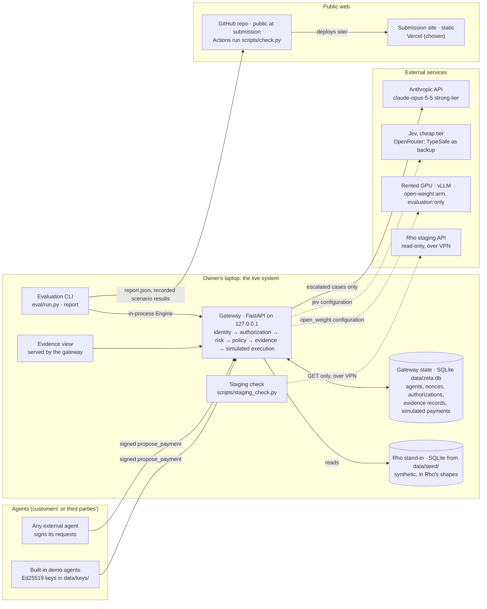

# Architecture: components, how they connect, and what runs where

Written 2026-10-27, with the engine's kernel built and the stages about to be built in parallel.
Status: **accepted** the same day; the choices are recorded in
[../decisions/0011-deployment-and-hosting.md](../decisions/0011-deployment-and-hosting.md). How the engine decides is in [product.md](product.md); the guardrails are in
[security.md](security.md).

Since then (2026-10-28): Jev runs as a model tier through OpenRouter, with TypeSafe as the backup
([../reference/jev.md](../reference/jev.md)); an open-weight model is a comparison arm
([../decisions/0014-open-weight-arm.md](../decisions/0014-open-weight-arm.md)); the gateway also
serves the case review page ([../decisions/0015-case-review-assistant.md](../decisions/0015-case-review-assistant.md)).

Since then (2026-10-29): the open-weight arm runs Qwen 3.6 27B on one rented GPU through vLLM
([../decisions/0018-self-hosted-open-weight-arm.md](../decisions/0018-self-hosted-open-weight-arm.md));
the AI labeller runs through the Anthropic API with no tools rather than as a Claude Code subagent
(case wording is still written by subagents, row 7); and no model runs when tier 0's floor is
already high ([../decisions/0017-no-model-on-a-high-floor.md](../decisions/0017-no-model-on-a-high-floor.md)).
The price of each design choice as the code stands is in [Design trade-offs](#design-trade-offs).

The hackathon credits ($25 Supabase, $25 Apify) are resources, not requirements. Each choice below
is made on what the demo, the judges and the reproduction need; where a credit fits, it says so.

## The whole picture

Solid lines run in every configuration; dotted lines run only in some configurations or on request. Everything that moves
money (simulated) or holds a secret stays on the laptop: the gateway, its keys, the Rho token and the
Anthropic key.

## Components and choices

Each row with a real alternative has a trade-off below. "Settled" means an earlier decision already
chose it.

| # | Component | Choice | Status |
| --- | --- | --- | --- |
| 1 | Gateway service | Python 3.13+, FastAPI, Pydantic, one process | Settled (0005) |
| 2 | Where the gateway runs for the demo | The owner's laptop; a hosted copy only in a recorded mode | Accepted (0011) |
| 3 | Gateway state | SQLite file, `data/zeta.db` | Accepted (0011) |
| 4 | Rho data | Snapshot stand-in from a committed seed; live read-only Rho as a connection proof | Settled (0002, 0005) |
| 5 | Strong model | Anthropic API directly, `claude-opus-5-5`, structured output | Accepted (0011) |
| 6 | Cheap model | Jev, through TypeSafe directly; OpenRouter if the direct key is slow to arrive | Settled tier (0009); route open |
| 7 | Case wording and labelling | Claude Code subagents on the owner's subscription | Settled (evaluation.md) |
| 8 | Evaluation | Offline CLI over the in-process engine; results committed as JSON | Accepted (0011) |
| 9 | Submission site | Static files from `site/`, on Vercel | Accepted (0011) |
| 10 | Interactive demo on the web | Recorded results of real engine runs, shown by the site; live only on the laptop | Accepted (0011) |
| 11 | Agent identity | Ed25519 request signatures; keys generated locally | Settled (0006, 0010) |
| 12 | Secrets | `.env` locally; the platform's environment variables if anything is hosted | Settled (AGENTS.md) |
| 13 | CI | GitHub Actions running `scripts/check.py` on every push to `main` | Accepted (0011) |
| 14 | Evidence store integrity | Plain rows in the first version; hash chain later | Settled (security.md) |

### 2. Where the gateway runs for the demo

| Option | For | Against |
| --- | --- | --- |
| **Laptop only** (chosen) | Matches the judges' quick start exactly; the live Rho read needs the VPN, which only the laptop has; keys and the Anthropic key never leave the machine; no cost; no public attack surface | No deployed URL for the live engine (the checklist accepts a screen capture instead); the live demo depends on the laptop and venue Wi-Fi |
| Render (free web service) | Simplest Python hosting, deploy from GitHub | Spins down after 15 minutes idle with a reported 20–60 s wake; free disk doesn't persist SQLite; the always-on tier is about $7/month |
| Google Cloud Run | Scales to zero with a short cold start; generous free tier (as reported by third parties) | Container and GCP project setup; no persistent disk, so state needs Postgres |
| Fly.io | Always-on small machine from about $2/month, volumes for SQLite | No free allowance for new accounts; a card and some setup |
| Vercel Python functions | Same platform as the site; the Hobby plan now allows 300 s functions, enough for a model call | Serverless: SQLite doesn't persist, so state needs Postgres (Supabase); cold starts; a different runtime from the judges' local one |

A public gateway is also a security question (security.md S6, S19): its demo endpoints are open by
design, and a public scenario endpoint that calls Opus is a way to spend the owner's API budget.
**Chosen:** run live on the laptop. If a hosted engine is wanted after the core works, host it in a
**recorded mode**: it serves the stored results of real runs, makes no model calls, has the admin
endpoints off, and says so on every response.

### 3. Gateway state

| Option | For | Against |
| --- | --- | --- |
| **SQLite** (chosen) | Zero setup for judges (`pip install` and run); one file; fast; the evaluation copies a fresh store per case in milliseconds; already wired in `zeta_one/db.py` | Not shared between machines; doesn't survive on serverless or free hosts |
| Supabase Postgres | Managed and durable; a hosted gateway could use it; its table view is a ready-made way to browse evidence records; the $25 credit covers a month of Pro, and the free plan is enough for this data | Judges would need a project and keys to reproduce, or a second code path; network latency on every check; free projects pause after a week idle (reported), so it must be woken before a demo; another credential to protect |
| Both, behind `db.connect` | Local and hosted from one codebase | Two SQL dialects to test in two days |

**Chosen:** SQLite now. Supabase becomes the right choice only together with a hosted gateway
(row 2). Even then, the evaluation and the judges' reproduction stay on SQLite, and Supabase holds
only the hosted copy's state. Keep the SQL in each module plain (no SQLite-only features) so that
move stays a small one.

### 5. Strong model access

| Option | For | Against |
| --- | --- | --- |
| **Anthropic API directly** (chosen) | Structured output, prompt caching, the Message Batches API at half price for repeat runs, refusal stop reasons the fail-closed path reads; the reported usage gives exact cost | A Console key and its billing, separate from the subscription |
| OpenRouter | One key for Claude, Jev and an open-weight arm | Another hop and its own terms; feature support for caching and batches varies by route; cost reporting less direct |
| Amazon Bedrock or Vertex | Enterprise path | Account setup for no gain in two days |

### 8. Evaluation

| Option | For | Against |
| --- | --- | --- |
| **Offline CLI, in-process engine** (chosen) | Fast; each case gets a fresh SQLite copy; no network except model calls; results are files that can be committed, diffed and shown | Not a service anyone else can call |
| Through the HTTP API | Tests the full request path, signatures included | Slower; needs a running server; little extra signal, since the deterministic cases already cover signatures |

Results go to `data/eval/results/` and `report.json`. The gateway serves the latest report at
`GET /v1/eval/latest`, and the site shows a copy.

### 9. Submission site hosting

The site is static: `site/` has no build step and makes no API calls.

| Option | For | Against |
| --- | --- | --- |
| **Vercel** (chosen) | Deploys from the private repo on every push, with preview URLs; free for this use; the same project could later host a recorded-mode gateway (row 2) next to Supabase | One more account |
| Netlify or Cloudflare Pages | Equivalent for a static site; Cloudflare's free tier is the most generous | Same as Vercel, without the gateway option |
| GitHub Pages | No new account; the repo goes public anyway | Pages on a private repo needs a paid GitHub plan, so the URL would exist only after the repo is made public on Thursday afternoon: too late to check it calmly |
| Supabase Storage | Uses the credit | Not built for websites: no clean URLs or deploy previews |

### 10. Interactive demo on the web

| Option | For | Against |
| --- | --- | --- |
| **Recorded real runs** (chosen) | After the real engine runs, a script writes each scenario result and the evaluation report as JSON into `site/data/`; the site shows real engine output, dated and labelled as recorded; nothing can break or be abused during a demo | Not live: a visitor can't change a scenario |
| Site calls a hosted gateway | Live on the web | Everything against row 2's hosted options, and the site would depend on an API at demo time |
| Live on the laptop only | The real thing, for the demo video and the live demo | Nothing on the deployed URL beyond the presentation |

**Chosen:** both of the first and third. Live on the laptop for the demo video and the live demo;
recorded real runs on the deployed site. The site session decides how to render them, against
[../reference/demo-api.md](../reference/demo-api.md), which those JSON files follow exactly.

### 13. CI

Several coding agents will push to `main` at once. The pre-push hook runs only
where it is enabled, so a GitHub Actions job running `python3 scripts/check.py` on every push makes
the check hold for everyone. It costs a few minutes of the private repo's free Actions allowance per
push. **Chosen:** added.

## Deployment views

| Where | What runs | Who uses it |
| --- | --- | --- |
| Owner's laptop | Gateway, SQLite state, seed, evidence view, evaluation CLI, live Rho read over VPN | The owner; the demo video; the live demo |
| A judge's machine | The same, from the README's quick start; no VPN, so no live Rho read; their own Anthropic key, or the recorded results without one | Judges reproducing the build |
| Vercel | The static site, with recorded real runs | Anyone with the submission link |
| GitHub | The public repo after submission; Actions running the checks | Judges reading the code |
| Anthropic, TypeSafe | Model calls on escalated cases | The gateway, never the browser |

## Cost

| Item | Expected |
| --- | --- |
| Anthropic API (development, evaluation, demo) | Under $35 |
| Jev | Cents, if the extension lands |
| Wording and labelling subagents | The owner's subscription |
| Site hosting and CI | $0 on free plans |
| Supabase | $0 unless a hosted gateway is added; the credit would cover it |
| Apify | Not used: nothing in the design needs web scraping |

## Design trade-offs

Added 2026-10-29. The product's main design choices, each with what it buys, what it costs and what
would reopen it. The decision records give the reasons; this section is the price of each choice as
the code stands. Where a number is a convention rather than an estimate, it says so.

### Product and integration

| Choice | What it buys | What it costs | Reopen when |
| --- | --- | --- | --- |
| One action, `propose_payment`, on business payables (0005) | A small authorization and a clear set of scenarios | The steps that create a vendor or change its bank details are not checked themselves; only their effect on a payment is | A customer shows where a fraudulent instruction first becomes a record a control could stop |
| Identity, authorization and risk kept as separate answers (0001, 0006) | A model can't repair a failed authorization; a reviewer sees which question failed and what would resolve it | More to read than one score | Kept even if a platform supplies identity or authorization itself |
| A gateway that alone holds the execution credentials (0003) | Enforcement that doesn't depend on the agent obeying anything | Covers only payments routed through it; a real deployment needs an integration that closes every other route. An advisory risk API would be easier to adopt but couldn't stop a payment | A platform offers a pre-execution hook |
| Simulated execution on synthetic records (0002) | Reproducible by anyone, no real money, no raw staging data in the repo | Shows behaviour on constructed cases, not fraud caught in operation; real execution also needs idempotency, lost-response handling and reconciliation | A sandbox with real writes, then a shadow-mode pilot |
| The agent states payee, method and amount even when it names a bill (0005) | Any disagreement with the bill is visible; money is integer minor units, compared only in one currency | Instalments, partial payments, credits and amended bills look like mismatches | Those payment shapes are in scope |

### Identity and authority

| Choice | What it buys | What it costs | Reopen when |
| --- | --- | --- | --- |
| Ed25519-signed requests from registered agent keys (0006) | Integrity and replay protection that can be shown and tested | Proves possession of a registered key, not that the software was uncompromised or that a person intended the payment; a stolen key acts as the agent. The ±5-minute timestamp window is a convention | Key rotation, compromise recovery and a standard credential issuer are needed |
| A small JSON authorization checked in code (0006) | A model can't reinterpret a limit; the authorization is copied into every record | Fields the checker doesn't know are kept but not enforced, which could look like enforcement | Several administrators or composed policies make a hand-written checker hard to reason about |
| Rolling limits that count held payments (0010) | Splitting a payment under the per-payment cap doesn't work, and concurrent holds can't share the same allowance | An abandoned hold keeps using allowance; limits are per agent, so several agents, or several payee records for one bank account, each get their own | Multi-agent or business-wide budgets are needed |
| Recheck the state when a person approves a held payment (0010) | Revocation or a changed payment method after the hold blocks the approval | A local recheck can't make a remote transfer atomic | Real execution exists |
| One shared admin token for approvals and findings (0010, 0013) | Agents are kept out of approval and registration with minimal setup | Holding the token doesn't prove who the person is; the `by` name is attribution, not authentication | Before any pilot, especially for trusting new destinations and unblocking accounts |

### Risk assessment

| Choice | What it buys | What it costs | Reopen when |
| --- | --- | --- | --- |
| Deterministic rules first; a model only on uncertain cases (0007, 0009) | Routine payments cost nothing and take milliseconds | The rules decide what a model never sees: an attack that trips no rule is allowed unread. On the `hard` set, two detectable frauds went through that way under every configuration that escalates; only a model on every payment caught them | Missed fraud among cases never escalated is measured on representative data |
| Hard flags set a floor no model can lower (0007, 0010) | A persuasive document can't clear a recent bank change or a bill mismatch | A floor is a policy on imperfect evidence, not proof. The instruction lexicon includes "urgent" and "immediately", so an honest urgent invoice always waits for a person, though the labelling guide would allow it when everything else fits | Floor-caused challenges are counted apart from model mistakes |
| Above the floor, the latest tier that ran decides (0007) | A model can clear false alarms, which is most of what the models did on `test` | A later model isn't independent evidence; both of Opus's `test` misses were lowerings of a soft signal | Lowerings on fraud cases are audited on representative data |
| Jev or no cheap tier; no small general-purpose model in between (0009) | A typed contract and one comparison arm | A product preference, not a measured result: the 0.8 and 0.9 thresholds are conventions and Jev's calibration is unmeasured, and an open-weight 27B model did well on `test` | Calibration, cost and latency are measured on this task |
| An open-weight model in Opus's place, with a section of its own (0014, 0019) | Shows what a model a business could host itself does at the same job | The two arms no longer read the same prompt, and the section was written from `dev` errors | Opus is run with the same section |
| No model when tier 0's floor is already high (0016, 0017) | Spend only where a model could change the risk level | Such records carry no model rationale, and a model can no longer turn a held high-risk payment into a block. Under `jev`, Jev still runs on a high floor, so `jev` and `engineered` differ in configuration as well as model | Review effort, not only model spend, is measured |
| A required model that fails holds the payment (0010) | Breaking or confusing the model never buys an allow | An outage, or input crafted to trigger refusals, adds review work, and review capacity is finite | Outage behaviour, queue limits and expiry of held payments are defined |
| Reuse a risk result for 24 hours; at most three fresh model assessments per agent, payee and method (0010) | Resubmitting until a model says yes doesn't work | "The same proposal" is defined by its fields; other agents or payee aliases aren't covered, and reuse doesn't ensure an obligation is paid only once. 24 hours and three are conventions | Retries across agents and aliases are threat-modelled |

The thresholds are conventions chosen for direction, not estimated optima:

| Convention | Why its direction makes sense | What is not established |
| --- | --- | --- |
| A bank change within 30 days is recent; so is a payee created within 30 days | Fresh changes deserve attention | That day 30 is the right cut-off |
| An amount outside 0.5–2 times the vendor's median is unusual | Large deviations can mark anomalies | That one band suits every vendor and billing pattern. The labelling guide treats exactly half the median as unusual, while tier 0's band includes 0.5 |
| A duplicate is the same amount to the payee within 7 days | Close repeats can be duplicates | That repeats outside it are harmless |
| The labelling guide accepts an old unconfirmed change after three settled payments linked to it | Payments to the same destination are better evidence than vendor age | That three is enough, or that a settled payment proves the right beneficiary |
| A confirmed bank change is trusted for 90 days; a blocked payment method never expires | Trust shouldn't last forever; a known bad destination shouldn't quietly return | That 90 days matches the risk, or that indefinite blocks without review are workable |

### Review and feedback

| Choice | What it buys | What it costs | Reopen when |
| --- | --- | --- | --- |
| One challenge type, `confirm` (0008) | A resolvable hold instead of a forced allow or block | Confirming the payer doesn't verify new supplier bank details; a challenge is an intervention, not a caught fraud | `verify_payee` and `renew_authorization` exist, with review time and wrong approvals measured |
| "Verified" means a person recorded one of four recognised methods (0012) | A complaint alone never becomes a label; every finding has provenance | The gateway records the person's statement, not the call-back or bank check itself, or the person's authority | Each method states what it establishes and carries its artifact |
| Findings turn into risk adjustments automatically (0013) | The loop closes without a model writing labels, scoped to one business and revocable | A `manipulated_agent` finding blocks the payment method as `payee_fraud` does, though an injected instruction can make an unwanted payment to the real vendor; a `legitimate` finding on a recent-change case trusts that change without saying the change itself was checked | Before the loop is shown as a general learning mechanism; until then, demonstrate it on an explicitly verified destination |
| Append-only records (0012, 0013) | Every decision can be traced to the finding behind it | Not proof against whoever controls the database, and not proof the original records were true | A pilot needs retention, correction and tamper evidence |
| A case review assistant with no verdict field; a local chat model (0015) | Evidence gathered by code, researched and summarised for a person, who decides | A fluent summary can still sway a reviewer; a cited source may not support the claim; the research and assembly calls go to Anthropic, and the chat stays local only while `CHAT_BASE_URL` points at the laptop | Its effect on review quality is measured |

### Implementation and evaluation

| Choice | What it buys | What it costs | Reopen when |
| --- | --- | --- | --- |
| Python, FastAPI, SQLite, one process (0005, 0011) | Few moving parts and a one-command reproduction | The gateway handles one request at a time under a lock, model calls included; no throughput or tail-latency claim | A load target exists |
| Two labels per case, truth and the decision the evidence supports ([evaluation.md](evaluation.md)) | Hindsight can't pass for detection; undetectable frauds are listed by name | Acceptable alternatives need fixed reasons, not ones added after seeing a model's answer | – |
| Synthetic `dev` and `test` from one generator, and a `hard` set written outside it | Reproducible, and labelled before scoring | A new seed doesn't remove a shared template; `hard` is small and drafted with AI help | Representative labelled data exists |
| The `unneeded_challenges` count in `GET /v1/stats` | A visible cost of friction | It counts every challenged payment later found legitimate, which doesn't mean the challenge was wrong given what was known at the time | Workload and justified-at-the-time disagreement are reported apart |
| Critical damping as the design metaphor (0004, 0008) | A memorable way to say "match the control to the risk" | Nothing here estimates ζ; the measures are detection, review burden, cost and latency | – |

### Why not a trained fraud model

There is no evidence here that language models beat a tree-based or other trained fraud model.
This build has no representative labelled payment history to train or validate one on, and its
cases turn on instructions and explanations in documents, so it uses deterministic permission
checks, auditable rule features and a pretrained model on selected cases. Trees are strong on
structured data in published benchmarks ([Grinsztajn et al., NeurIPS 2022](https://papers.nips.cc/paper_files/paper/2022/hash/0378c7692da36807bdec87ab043cdadc-Abstract.html)),
which is a reason to include one as a baseline when data exists, not a result about this domain. A
fair comparison would give each system the same information at decision time, split by time and
by vendor, and compare at the same review workload. A trained model would replace or add to the
risk tier; it would never decide whether to honour a revoked authorization.

## Later

- A recorded-mode hosted gateway, if it's worth it after the core works; that is when Supabase would
  come in.

Sources for the hosting terms above, checked 2026-10-27 through search results rather than the
vendors' own pages unless noted: Vercel's
[function limits](https://vercel.com/docs/functions/limitations) (vendor);
[Render's changelog](https://render.com/changelog/free-web-services-now-remain-active-while-receiving-websocket-messages)
(vendor) and [a 2026 review](https://dev.to/build996/render-free-hosting-review-2026-deploy-web-apps-databases-and-cron-jobs-for-free-b39);
[Fly.io's discontinued plans](https://fly.io/docs/about/discontinued-plans/) (vendor);
[Supabase pricing in 2026](https://makerkit.dev/blog/saas/supabase-pricing);
[Cloud Run pricing](https://cloud.google.com/run/pricing) (vendor; free-tier figures not confirmed
there). Check the vendor's page before relying on a limit.
