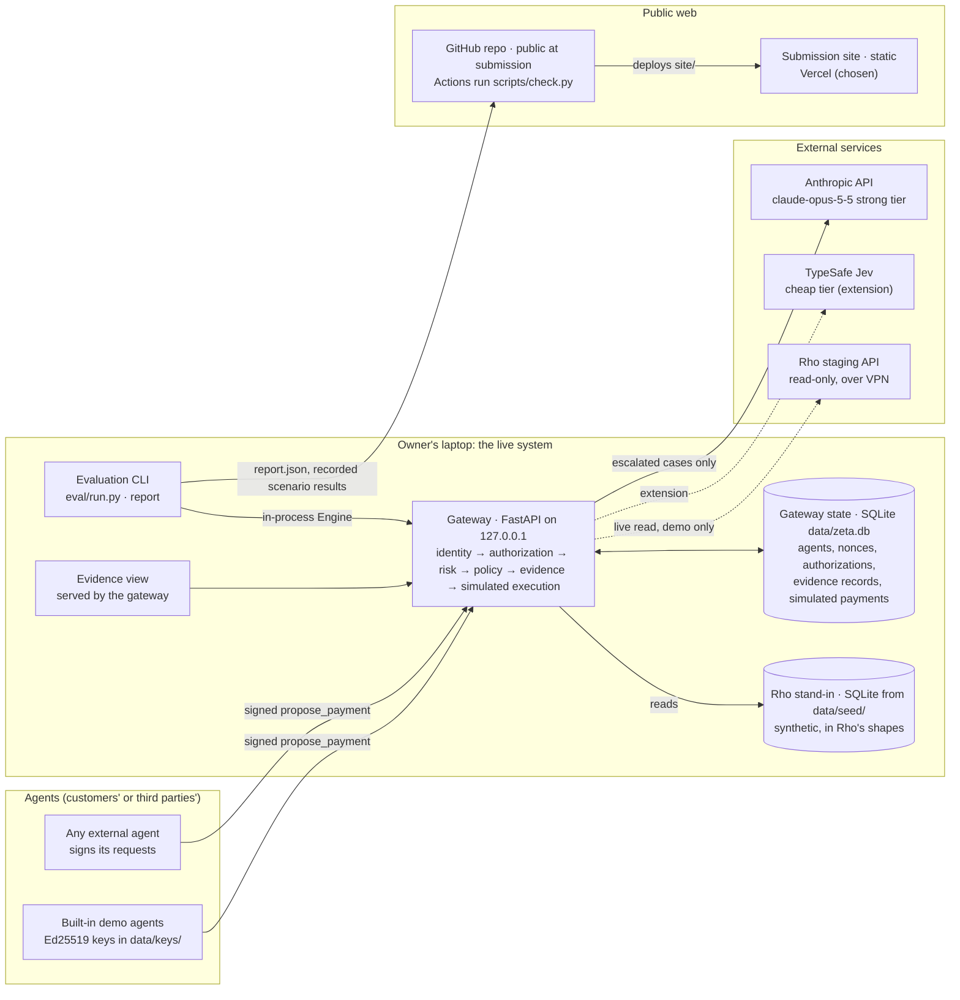

# Architecture: components, how they connect, and what runs where

Written 2026-10-27, with the engine's kernel built and the stages about to be built in parallel.
Status: **accepted** the same day; the choices are recorded in
[../decisions/0011-deployment-and-hosting.md](../decisions/0011-deployment-and-hosting.md). How the engine decides is in [implementation-plan.md](implementation-plan.md);
who builds each module is in [parallel-build.md](parallel-build.md); the guardrails are in
[security.md](security.md).

The hackathon credits ($25 Supabase, $25 Apify) are resources, not requirements. Each choice below
is made on what the demo, the judges and the reproduction need; where a credit fits, it says so.

## The whole picture

Solid lines run in the first version; dotted lines are optional or extensions. Everything that moves
money (simulated) or holds a secret stays on the laptop: the gateway, its keys, the Rho token and the
Anthropic key.

## Components and choices

Each row with a real alternative has a tradeoff below. "Settled" means an earlier decision already
chose it.

| # | Component | Choice | Status |
| --- | --- | --- | --- |
| 1 | Gateway service | Python 3.13+, FastAPI, Pydantic, one process | Settled (0005) |
| 2 | Where the gateway runs for the demo | The owner's laptop; a hosted copy only in a recorded mode | Accepted (0011) |
| 3 | Gateway state | SQLite file, `data/zeta.db` | Accepted (0011) |
| 4 | Rho data | Snapshot stand-in from a committed seed; live read-only Rho as a connection proof | Settled (0002, 0005) |
| 5 | Strong model | Anthropic API directly, `claude-opus-5-5`, structured output | Accepted (0011) |
| 6 | Cheap model | Jev, through TypeSafe directly; OpenRouter if the direct key is slow to arrive | Settled tier (0009); route open |
| 7 | Case wording and labelling | Claude Code subagents on the owner's subscription | Settled (evaluation.md) |
| 8 | Evaluation | Offline CLI over the in-process engine; results committed as JSON | Accepted (0011) |
| 9 | Submission site | Static files from `site/`, on Vercel | Accepted (0011) |
| 10 | Interactive demo on the web | Recorded results of real engine runs, shown by the site; live only on the laptop | Accepted (0011) |
| 11 | Agent identity | Ed25519 request signatures; keys generated locally | Settled (0006, 0010) |
| 12 | Secrets | `.env` locally; the platform's environment variables if anything is hosted | Settled (AGENTS.md) |
| 13 | CI | GitHub Actions running `scripts/check.py` on every push to `main` | Accepted (0011) |
| 14 | Evidence store integrity | Plain rows in the first version; hash chain later | Settled (security.md) |

### 2. Where the gateway runs for the demo

| Option | For | Against |
| --- | --- | --- |
| **Laptop only** (chosen) | Matches the judges' quick start exactly; the live Rho read needs the VPN, which only the laptop has; keys and the Anthropic key never leave the machine; no cost; no public attack surface | No deployed URL for the live engine (the checklist accepts a screen capture instead); the Hack Fair demo depends on the laptop and venue Wi-Fi |
| Render (free web service) | Simplest Python hosting, deploy from GitHub | Spins down after 15 minutes idle with a reported 20–60 s wake; free disk doesn't persist SQLite; the always-on tier is about $7/month |
| Google Cloud Run | Scales to zero with a short cold start; generous free tier (as reported by third parties) | Container and GCP project setup; no persistent disk, so state needs Postgres |
| Fly.io | Always-on small machine from about $2/month, volumes for SQLite | No free allowance for new accounts; a card and some setup |
| Vercel Python functions | Same platform as the site; the Hobby plan now allows 300 s functions, enough for a model call | Serverless: SQLite doesn't persist, so state needs Postgres (Supabase); cold starts; a different runtime from the judges' local one |

A public gateway is also a security question (security.md S6, S19): its demo endpoints are open by
design, and a public scenario endpoint that calls Opus is a way to spend the owner's API budget.
**Chosen:** run live on the laptop. If a hosted engine is wanted after the core works, host it in a
**recorded mode**: it serves the stored results of real runs, makes no model calls, has the admin
endpoints off, and says so on every response.

### 3. Gateway state

| Option | For | Against |
| --- | --- | --- |
| **SQLite** (chosen) | Zero setup for judges (`pip install` and run); one file; fast; the evaluation copies a fresh store per case in milliseconds; already wired in `zeta_one/db.py` | Not shared between machines; doesn't survive on serverless or free hosts |
| Supabase Postgres | Managed and durable; a hosted gateway could use it; its table view is a ready-made way to browse evidence records; the $25 credit covers a month of Pro, and the free plan is enough for this data | Judges would need a project and keys to reproduce, or a second code path; network latency on every check; free projects pause after a week idle (reported), so it must be woken before the Hack Fair; another credential to protect |
| Both, behind `db.connect` | Local and hosted from one codebase | Two SQL dialects to test in two days |

**Chosen:** SQLite now. Supabase becomes the right choice only together with a hosted gateway
(row 2). Even then, the evaluation and the judges' reproduction stay on SQLite, and Supabase holds
only the hosted copy's state. Keep the SQL in each module plain (no SQLite-only features) so that
move stays a small one.

### 5. Strong model access

| Option | For | Against |
| --- | --- | --- |
| **Anthropic API directly** (chosen) | Structured output, prompt caching, the Message Batches API at half price for repeat runs, refusal stop reasons the fail-closed path reads; the reported usage gives exact cost | A Console key and its billing, separate from the subscription |
| OpenRouter | One key for Claude, Jev and an open-weight arm | Another hop and its own terms; feature support for caching and batches varies by route; cost reporting less direct |
| Amazon Bedrock or Vertex | Enterprise path | Account setup for no gain in two days |

### 8. Evaluation

| Option | For | Against |
| --- | --- | --- |
| **Offline CLI, in-process engine** (chosen) | Fast; each case gets a fresh SQLite copy; no network except model calls; results are files that can be committed, diffed and shown | Not a service anyone else can call |
| Through the HTTP API | Tests the full request path, signatures included | Slower; needs a running server; little extra signal, since the deterministic cases already cover signatures |

Results go to `data/eval/results/` and `report.json`. The gateway serves the latest report at
`GET /v1/eval/latest`, and the site shows a copy.

### 9. Submission site hosting

The site is static: `site/` has no build step and makes no API calls.

| Option | For | Against |
| --- | --- | --- |
| **Vercel** (chosen) | Deploys from the private repo on every push, with preview URLs; free for this use; the same project could later host a recorded-mode gateway (row 2) next to Supabase | One more account |
| Netlify or Cloudflare Pages | Equivalent for a static site; Cloudflare's free tier is the most generous | Same as Vercel, without the gateway option |
| GitHub Pages | No new account; the repo goes public anyway | Pages on a private repo needs a paid GitHub plan, so the URL would exist only after the repo is made public on Thursday afternoon: too late to check it calmly |
| Supabase Storage | Uses the credit | Not built for websites: no clean URLs or deploy previews |

### 10. Interactive demo on the web

| Option | For | Against |
| --- | --- | --- |
| **Recorded real runs** (chosen) | After the real engine runs, a script writes each scenario result and the evaluation report as JSON into `site/data/`; the site shows real engine output, dated and labelled as recorded; nothing can break or be abused at the Hack Fair | Not live: a visitor can't change a scenario |
| Site calls a hosted gateway | Live on the web | Everything against row 2's hosted options, and the site would depend on an API at demo time |
| Live on the laptop only | The real thing, for the Loom and the Hack Fair | Nothing on the deployed URL beyond the presentation |

**Chosen:** both of the first and third. Live on the laptop for the Loom and the Hack Fair;
recorded real runs on the deployed site. The site session decides how to render them, against
[../reference/demo-api.md](../reference/demo-api.md), which those JSON files follow exactly.

### 13. CI

Several coding agents will push to `main` at once (parallel-build.md). The pre-push hook runs only
where it is enabled, so a GitHub Actions job running `python3 scripts/check.py` on every push makes
the check hold for everyone. It costs a few minutes of the private repo's free Actions allowance per
push. **Chosen:** added.

## Deployment views

| Where | What runs | Who uses it |
| --- | --- | --- |
| Owner's laptop | Gateway, SQLite state, seed, evidence view, evaluation CLI, live Rho read over VPN | The owner; the Loom; the Hack Fair demo |
| A judge's machine | The same, from the README's quick start; no VPN, so no live Rho read; their own Anthropic key, or the recorded results without one | Judges reproducing the build |
| Vercel | The static site, with recorded real runs | Anyone with the submission link |
| GitHub | The public repo after submission; Actions running the checks | Judges reading the code |
| Anthropic, TypeSafe | Model calls on escalated cases | The gateway, never the browser |

## Cost

| Item | Expected |
| --- | --- |
| Anthropic API (development, evaluation, demo) | Under $35, as budgeted in [implementation-plan.md](implementation-plan.md#evaluation-runner) |
| Jev | Cents, if the extension lands |
| Wording and labelling subagents | The owner's subscription |
| Site hosting and CI | $0 on free plans |
| Supabase | $0 unless a hosted gateway is added; the credit would cover it |
| Apify | Not used: nothing in the design needs web scraping |

## Later

- A recorded-mode hosted gateway, if it's worth it after the core works; that is when Supabase would
  come in.

Sources for the hosting terms above, checked 2026-10-27 through search results rather than the
vendors' own pages unless noted: Vercel's
[function limits](https://vercel.com/docs/functions/limitations) (vendor);
[Render's changelog](https://render.com/changelog/free-web-services-now-remain-active-while-receiving-websocket-messages)
(vendor) and [a 2026 review](https://dev.to/build996/render-free-hosting-review-2026-deploy-web-apps-databases-and-cron-jobs-for-free-b39);
[Fly.io's discontinued plans](https://fly.io/docs/about/discontinued-plans/) (vendor);
[Supabase pricing in 2026](https://makerkit.dev/blog/saas/supabase-pricing);
[Cloud Run pricing](https://cloud.google.com/run/pricing) (vendor; free-tier figures not confirmed
there). Check the vendor's page before relying on a limit.
